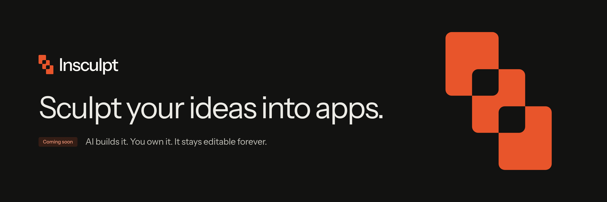

# Insculpt
 
### Sculpt your ideas into apps.
 
**AI builds it. You own it. It stays editable forever.**

 
Insculpt is an AI-first visual builder for production-grade full-stack web apps: sites, blogs, dashboards, internal tools and SaaS apps. It is made for indie developers and small teams, and it is simple enough for people who don't code.
 
> 🚧 **Coming soon.** We are building in the open as much as we can. Follow along below.
 
---
 
## What makes Insculpt different
 
- **Schema-first.** Your app is stored as a clean, typed schema, not a pile of generated code. It stays tidy after thousands of edits.
- **AI-first, human-approved.** Insculpt AI writes to the schema, never to raw code. Every change is a draft you review before it goes live.
- **Always editable.** Change anything by hand, with AI, or with your own AI tools. No lock-in, and you can export your data anytime.
- **Every app is a platform.** Each app gets its own API, typed SDK and events, generated from the schema.
- **No dead ends.** Start visual, ask AI, add code components, write Functions, or connect to outside services. Each step keeps your app editable.
## Modules
 
| Module | What it does |
|---|---|
| **Studio** | Visual UI builder with themes and live preview |
| **Content** | CMS with collections, SEO and localization |
| **Data** | Database, end-user auth and an automatic API |
| **Flows** | Automations and backend workflows |
| **Functions** | Sandboxed custom code when you need it |
| **Insculpt AI** | Built-in AI in every module, plus MCP so you can bring your own AI |
 
Only Studio is on by default. Turn on the others when you need them.
 
## Who it's for
 
- **Non-coders** who want to build real apps from a prompt or a template.
- **Indie developers** who want speed without giving up control.
- **Small SaaS teams** who want one workspace for UI, content, data and logic.
---
 
## Follow Insculpt
 

 
Join our [Discord](https://discord.gg/HZqnScmyf7) to chat with the team and get early access news.
 
---
 
© 2027 Insculpt. All rights reserved.
 
